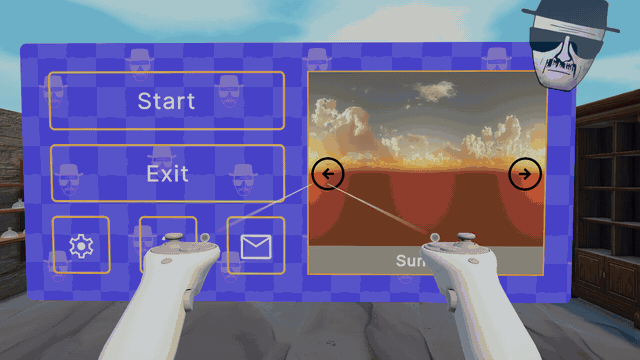
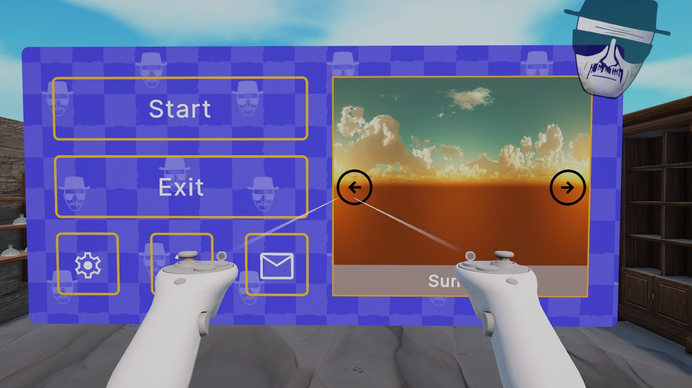
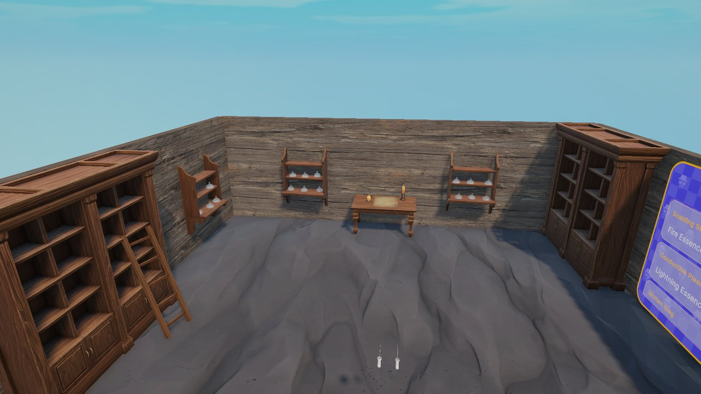
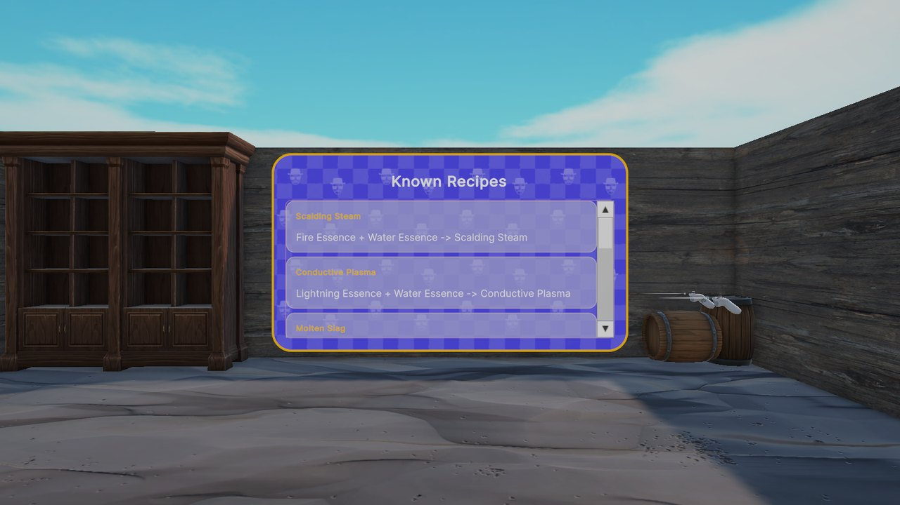
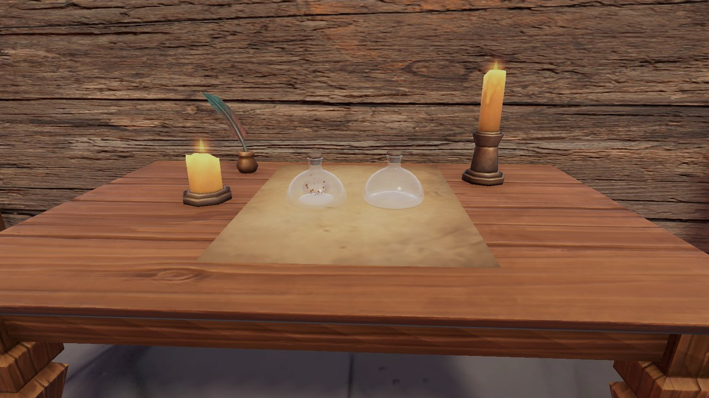
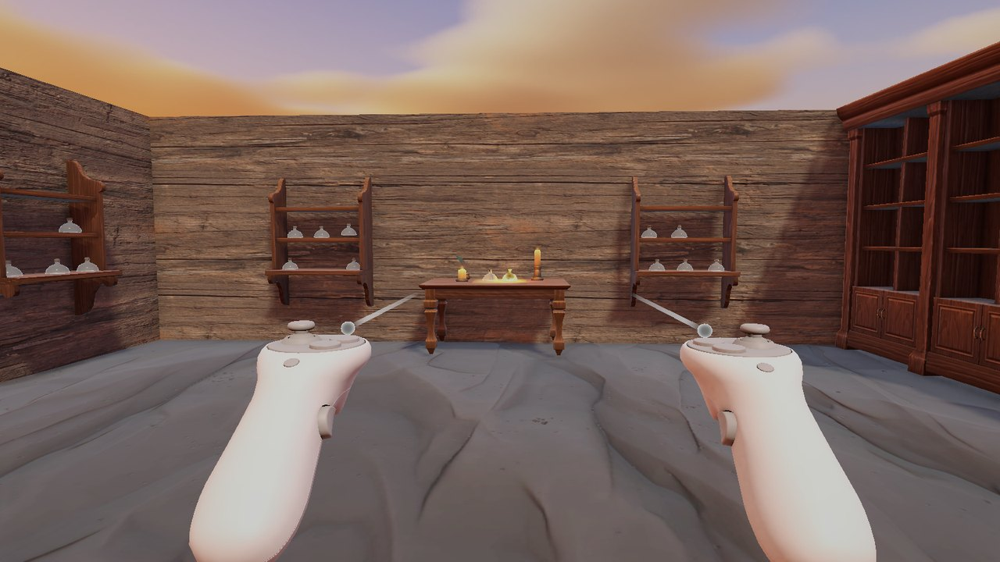
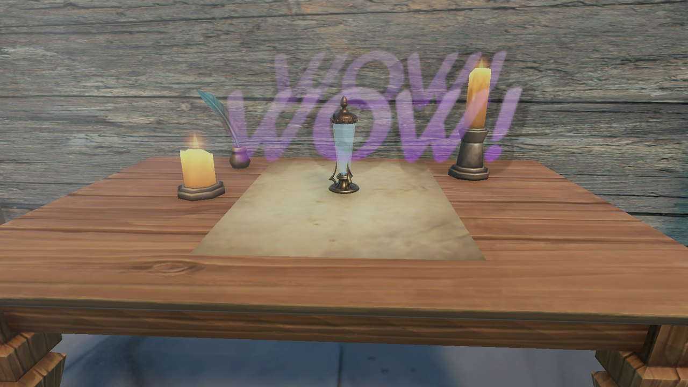
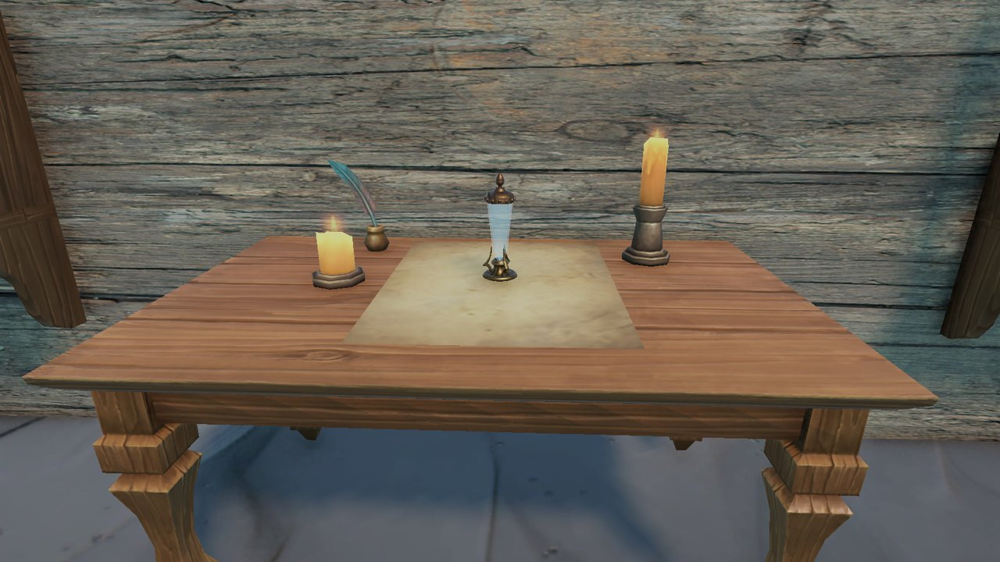
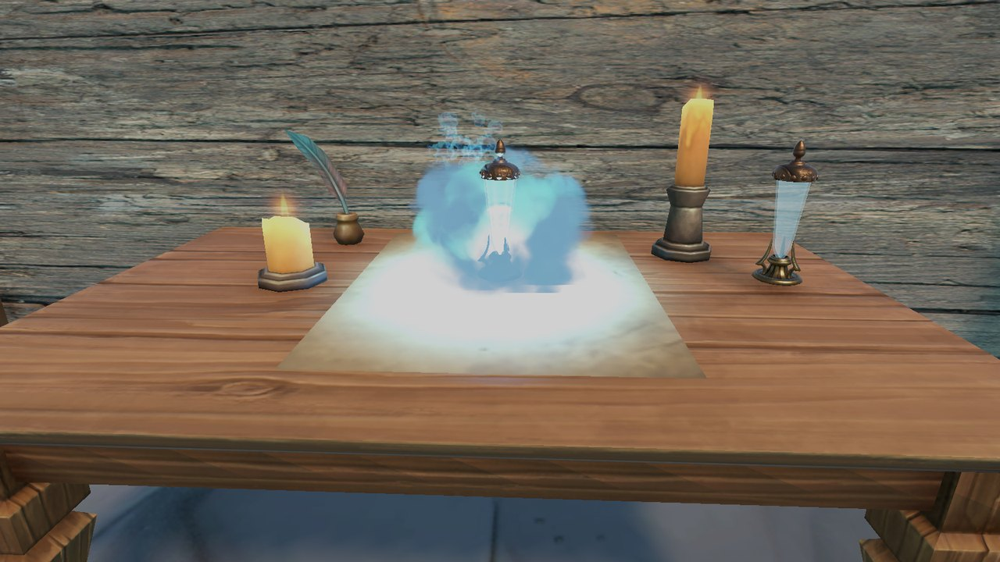

# Elemental Heisenberg

A VR alchemy lab built in Unity. Pick up elemental essences from the shelves, combine them on the alchemy table, and strike the anvil with the hammer to trigger the reaction. Each recipe changes the sky, tints the world, plays a reaction effect, and creates a new vial. Some of those vials are ingredients for higher-tier recipes.



<sub>Recorded in the Unity editor (Play mode, `MainScene`). For the recording, the vials were placed and each reaction was triggered by an editor script that calls the same `InteractionCoordinator.TryExecuteReaction()` the anvil uses.</sub>


## Contents

- [Gameplay](#gameplay)
- [Screenshots](#screenshots)
- [Recipes](#recipes)
- [Getting started](#getting-started)
- [How it works](#how-it-works)
- [Adding a new recipe](#adding-a-new-recipe)
- [Project layout](#project-layout)

## Gameplay

1. **Start** from the world-space main menu.
2. **Pick ingredients**: elemental essences (Fire, Water, Earth, Air, Ice, Lightning, Holy, Dark, Magic, Void) sit on the lab shelves. Hovering a vial shows its name.
3. **Prep the reaction**: set the vials down on the alchemy table. When they match a recipe, the zone is *prepped* and the sky changes.
4. **Strike the anvil** with the hammer to run the reaction: a screen tint, a sound, a reaction effect, and a new vial appear on the table.
5. **Go further**: combine results into higher-tier substances (for example Molten Slag + Ice → Volcanic Glass). The **Known Recipes** board lists the combinations, and quests guide what to brew next.

## Screenshots

<table>
  <tr>
    <td width="50%"></td>
    <td width="50%"></td>
  </tr>
  <tr>
    <td align="center"><sub>World-space main menu</sub></td>
    <td align="center"><sub>The alchemy lab</sub></td>
  </tr>
  <tr>
    <td></td>
    <td></td>
  </tr>
  <tr>
    <td align="center"><sub>The Known Recipes board</sub></td>
    <td align="center"><sub>Earth and Fire essences placed on the alchemy table</sub></td>
  </tr>
  <tr>
    <td></td>
    <td></td>
  </tr>
  <tr>
    <td align="center"><sub>A matching recipe preps the zone and changes the sky</sub></td>
    <td align="center"><sub>Striking the anvil runs the reaction</sub></td>
  </tr>
  <tr>
    <td></td>
    <td></td>
  </tr>
  <tr>
    <td align="center"><sub>Volcanic Glass, a tier-2 result made from Molten Slag + Ice</sub></td>
    <td align="center"><sub>Conductive Plasma (Lightning + Water)</sub></td>
  </tr>
</table>

## Recipes

The recipes defined in `MainScene` (on the `InteractionCoordinator`):

| Recipe | Ingredients | Tier |
|---|---|---|
| Scalding Steam | Fire Essence + Water Essence | 1 |
| Conductive Plasma | Lightning Essence + Water Essence | 1 |
| Molten Slag | Earth Essence + Fire Essence | 1 |
| Petrifying Mud | Earth Essence + Water Essence | 1 |
| Pure Essence | Holy Essence + Water Essence | 1 |
| Superheated Ion Cloud | Scalding Steam + Lightning Essence | 2 |
| Volcanic Glass | Molten Slag + Ice Essence | 2 |
| Living Quicksand | Petrifying Mud + Dark Essence | 2 |

Ingredient order doesn't matter: a recipe matches when exactly its vials are in the zone.

## Getting started

**Requirements**

- Unity **6000.3.8f1**, installed through Unity Hub
- A PC VR setup running OpenXR with Meta Quest (Oculus Touch) controllers, for example Quest via Link or Air Link

**Run it**

1. Clone the repository and add it to Unity Hub (**Add → Add project from disk**).
2. Open it with Unity 6000.3.8f1. The first import takes a while.
3. Open `Assets/Scenes/MainScene.unity` and press **Play** with the headset connected.

To test without a headset, the project includes the XR Interaction Toolkit's **XR Interaction Simulator** sample (`Assets/Samples/XR Interaction Toolkit/3.3.1/XR Interaction Simulator`). Drop its prefab into the scene to drive the rig with mouse and keyboard.

## How it works

```text
Vial (ItemInstance → ItemDefinition)
   │  placed in / removed from
   ▼
AlchemyZone ──OnIngredientsChanged──► InteractionCoordinator  (list of AlchemyReactionRecipe)
                                           │ recipe matches → zone prepped
                                           │                  AtmosphereController.SetSkybox(prepSkybox)
AnvilSurface ──hammer strike──► TryExecuteReaction()
                                           │ ScreenTintController.SetTint(screenTint)
                                           │ audio + reaction effect
                                           ▼
                              AlchemyZone.ExecuteSpawn → ingredients consumed,
                              result vial spawned with the recipe's ItemDefinition
                                           ▼
                              QuestManager.CheckCompletion(result) → quest HUD
```

| Script (`Assets/Scripts`) | Role |
|---|---|
| `Interactions/ItemDefinition` | ScriptableObject describing a substance: id, display name, effect prefab |
| `Interactions/ItemInstance` | Marks a scene vial as a given `ItemDefinition`; can be re-defined when spawned as a result |
| `Interactions/AlchemyZone` | Trigger volume that tracks the vials on the table; spawns the result vial |
| `Interactions/InteractionCoordinator` | Single source of truth for recipes; preps the zone and executes reactions |
| `Interactions/AnvilSurface` | Detects a hard enough hammer strike and calls `TryExecuteReaction()` |
| `Interactions/AtmosphereController`, `ScreenTintController` | Skybox swap and URP colour-filter tint |
| `Interactions/AlchemyRecipeBoard` | The *Known Recipes* board (recipes marked `isSecret` are hidden) |
| `Interactions/QuestManager`, `QuestHUDController` | Quest progression and HUD |
| `Interactions/TooltipOnHover` | Floating name label when a vial is hovered |
| `WorldSpaceMenuGate`, `WorldSpaceMenuFollower` | World-space main menu that locks gameplay until **Start** |
| `WeaponToggleEquip` | Toggles the hammer on the left controller with an input action |

## Adding a new recipe

1. **Create the substances**: `Create → Interactions → Item Definition` for each new result, and fill in its id, display name and effect prefab.
2. **Add the recipe**: select the `InteractionCoordinator` (on the *XR Interaction Manager* object in `MainScene`) and add an entry to **Recipes**:

   | Field | Purpose |
   |---|---|
   | `label` | Name shown on the recipe board and in logs |
   | `reactingVials` | The `ItemDefinition`s that must be in the zone (any order) |
   | `resultVialPrefab` / `resultDefinition` | Vial to spawn and the substance it becomes |
   | `reactionPrefab` | Effect played when the reaction runs |
   | `prepSkybox` | Skybox shown while the zone is prepped |
   | `screenTint` | URP colour-filter tint applied when the reaction runs |
   | `audioFeedback` | Sound played on reaction |
   | `resultTooltip`, `resultEffectOverride`, `resultIntensity` | Optional overrides for the result vial's label and effect |
   | `isSecret` | Hide the recipe from the *Known Recipes* board |

3. **Make the ingredients available**: place vials on the shelves with an `ItemInstance` pointing at each ingredient's `ItemDefinition` and the `Vial` tag (the zone only counts objects tagged `Vial`).

## Project layout

```text
Assets/
  Scenes/MainScene.unity      the game scene (the only scene in the build)
  Scripts/                    gameplay scripts (Interactions/ holds the alchemy systems)
  Interactions/               ItemDefinition assets (Item_Fire, Item_MoltenSlag, ...)
  Editor/                     editor helpers (XR fixups, physics layer matrix, VFX populator)
  Samples/                    XR Interaction Toolkit samples
docs/media/                   README GIF and screenshots
```
